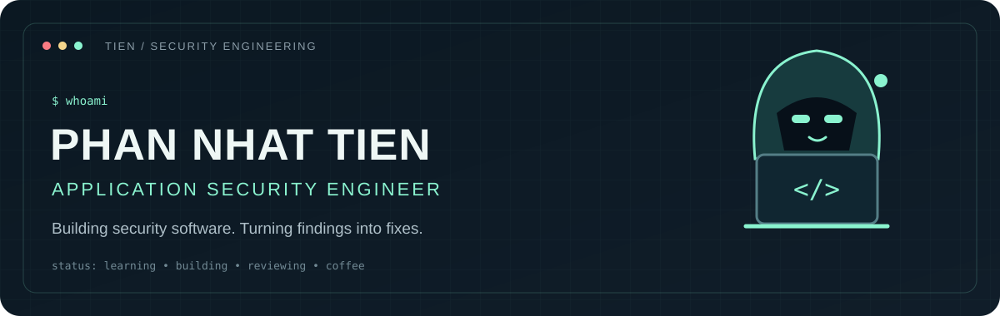
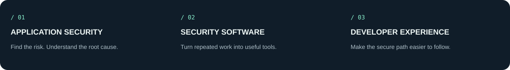
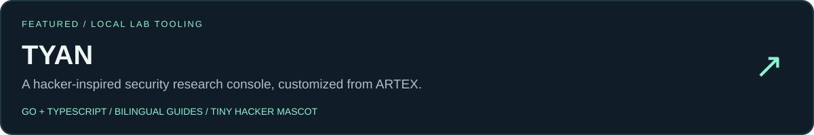
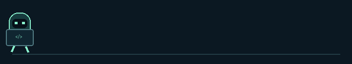

<p align="center">
  
</p>

<p align="center">
  <a href="#about">About</a> · <a href="#what-i-care-about">Focus</a> · <a href="#featured-work">Featured work</a> · <a href="README.vi.md">Tiếng Việt</a>
</p>

## About

Hi, I'm **Phan Nhật Tiến**, an **Application Security Engineer working at a Japanese company**. I build security software and tools that help turn security work into something practical, repeatable, and easier to use.

I like the space where **security meets software engineering**: understanding how applications fail, improving how they are built, and automating the repetitive parts along the way.

> My love language is a reproducible bug report. Preferably with a fix.

## What I care about



- **AppSec:** understand the application, trace the risk, and make findings actionable.
- **Security engineering:** build tools that solve real problems and are pleasant to use.
- **Learning in public:** share useful experiments, clear documentation, and lessons from building.

## Featured work

<a href="https://github.com/PhanNhatTien090/TYAN"></a>

**[TYAN](https://github.com/PhanNhatTien090/TYAN)** — my customization of **[ARTEX](https://github.com/mhtsec/ARTEX)**, with a refreshed interface, English/Vietnamese documentation, Windows launchers, and a tiny hacker mascot that takes its patrol very seriously.

Built for learning and **isolated local labs**, within the project's usage restrictions. Original project credit and license notices are preserved in the repository.

## In the toolbox

Tools and languages you'll find across my public repositories:

`Go` · `Python` · `TypeScript` · `JavaScript` · `Shell` · `Git`

<details>
<summary><b>Open the after-hours terminal</b></summary>

```text
$ whoami
AppSec engineer. Security software builder.

$ git status
On branch: probably-needs-more-coffee

$ sudo make coffee
Permission granted. Scope: one cup.

$ echo $SECURITY_PHILOSOPHY
Understand it. Fix it. Write it down.
```

</details>

<p align="center">
  
  <br />
  <sub>Small mascot. Very serious perimeter patrol. Zero production access.</sub>
</p>
